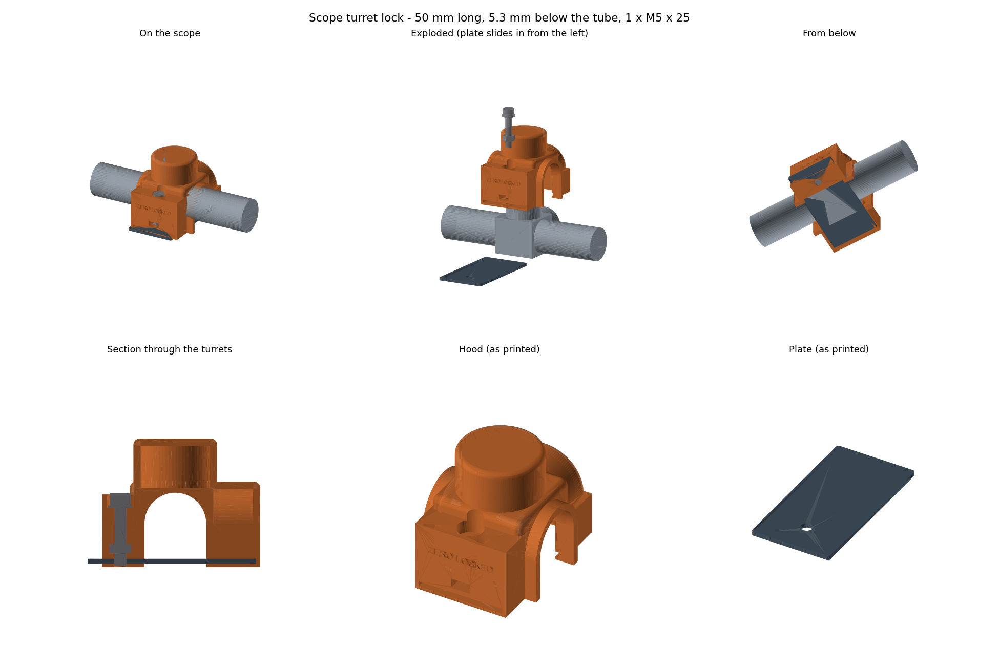
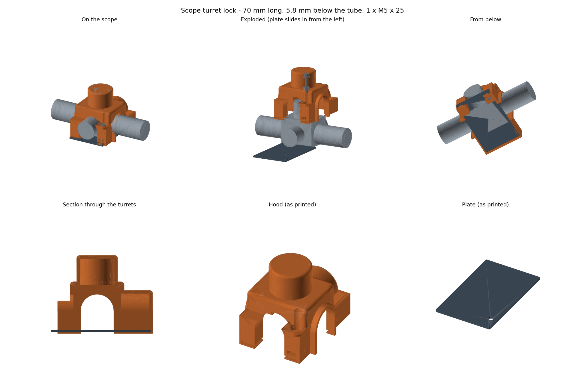

# Scope turret lock

A parametric, 3D-printable cover for a riflescope's turrets, so nobody can
move the zero on shared club rifles. It fits with the scope left in its
rings and locks with one bolt and a hex key, no padlock.

Generated with [CadQuery](https://github.com/CadQuery/cadquery) from
`params.json` plus a per-scope profile.

| Nikko Stirling Mountmaster 3-9x40 AO | Generic 30 mm tube |
|---|---|
|  |  |

## Design

A hood comes down over the turrets from above, and a thin plate slides in
underneath like a pencil-box lid. One M5×25 bolt goes up through the lock
block and the plate: with the plate in, the hood can't lift; with the bolt
in, the plate can't slide out.

Hardware: 1 × M5×25 socket head bolt, washer and plain hex nut.

## Print it

- **Material:** PLA works. Tested on a Bambu Lab A1 at 0.20 mm.
- Hoods print on their side with tree supports under the plate slot roof
  only. Plates print flat with no supports.
- **Files:** `<scope>_hood.stl` and `<scope>_plate.stl` in each profile
  folder, a Bambu Studio project for six Nikko locks, and fit-test pieces in
  `fit_test/`.

## Generate

```bash
python -m venv venv
venv\Scripts\pip install -r requirements.txt
venv\Scripts\python generate.py                 # every profile
venv\Scripts\python generate.py scopes/<name>    # one profile
venv\Scripts\python fit_test.py                  # fit test pieces
```

New scope: copy `scopes/generic_30mm`, rename it, and measure. All lengths
are in mm. If your rifle has less room under the scope, thin
`PLATE_THICKNESS`, `GROOVE_LIP` or `PLATE_GAP`.

## License

[MIT](LICENSE)
